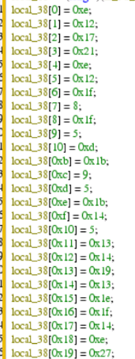
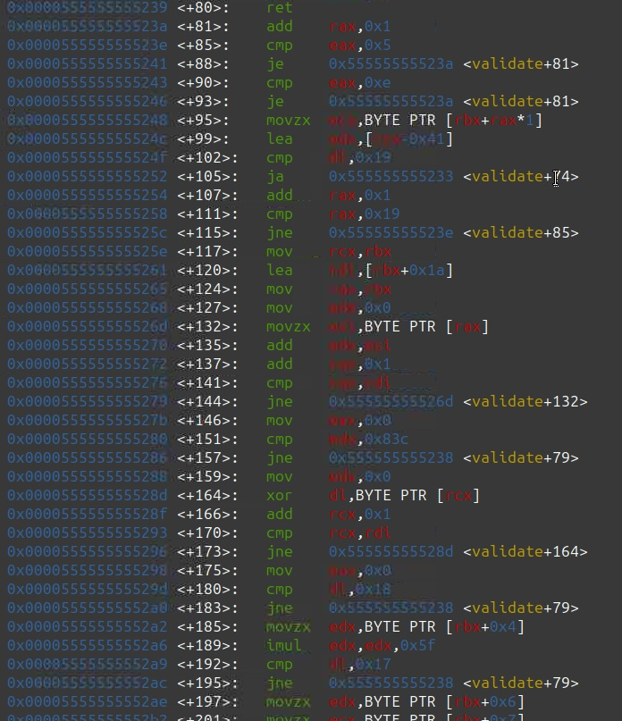

# Red Queen Protocol - (TryHackMe)

## Task 2 Level 1 - Simple Analysis

Reverse engineering is the process of analyzing a compiled program to understand what it does without access to its original source code. When software ships, human-readable code is compiled down into machine instructions, and reverse engineers work backwards from those instructions to recover intent, logic, and hidden data.

It shows up constantly in real-world scenarios:

- Malware analysts use it to work out what a sample actually does.
- Vulnerability researchers use it to find bugs in software with no available source code.
- Security teams use it to audit third-party binaries they didn't write.

```bash
emp7749@HIVE-NODE-7749:~/recovered_terminals$ checksec --file=hive_terminal --format=json | jq
{
  "hive_terminal": {
    "relro": "full",
    "canary": "yes",
    "nx": "yes",
    "pie": "yes",
    "rpath": "no",
    "runpath": "no",
    "symbols": "yes",
    "fortify_source": "yes",
    "fortified": "1",
    "fortify-able": "2"
  }
}
```

Checksec opens up a deep topic. For starters, here are the security features worth looking for:

- Canary - Detects stack buffer overflows before they're exploited.
- NX - Marks memory areas non-executable, blocking classic shellcode injection
- PIE - Randomizes where the binary loads in memory on each run.
- RELRO - Restricts what the dynamic linker is allowed to overwrite after startup.

```bash
mp7749@HIVE-NODE-7749:~/recovered_terminals$ file hive_terminal 
hive_terminal: ELF 64-bit LSB pie executable, x86-64, version 1 (SYSV), dynamically linked, interpreter /lib64/ld-linux-x86-64.so.2, BuildID[sha1]=2f972fcea000dde19b449129833854398c6516f8, for GNU/Linux 3.2.0, not stripped

emp7749@HIVE-NODE-7749:~/recovered_terminals$ strings hive_terminal 

=================================
   HIVE TERMINAL ACCESS v2.1    
  Umbrella Corporation Internal  
Access Granted. Welcome to The Hive.
Access Denied. Incident logged.
Enter Employee ID: 
**UMBRELLA-7749
THM{REDACTED}**
9*3$"

```

## Task 3 Level 2 - Static Analysis

Static analysis means examining a binary without running it. You can read disassembled instructions or reconstructed pseudo-C to work out what the program does. This is the natural next step if the `strings` command comes up empty: instead of looking for plaintext, you read the logic that produces certain values.

The standard tool for this is Ghidra, a free, open-source reverse engineering suite that disassembles binaries, decompiles functions into readable pseudocode, and lets you browse data structures and do cross-references.

Other similar tools are:

- IDA Free
- Binary Ninja
- objdump
- dnSpy (for .NET applications)
- uncompyle6 (for Python bytecode)

When the code is simple enough to read, static analysis gets the job done without even running the program.

When you inspect the binary with `ghidra` we can observe two facts:

`decode_code`  and `strcmp` ⇒ meaning the values are decoded or XOR’ed with the key `0x5a`.

Now analyse the `decode_code` function to see how the program behaves internally.

Bingo!!!,we got the hex values that we can put to use in further step.



Now,lets create a python script that decodes this data and give the flag.

```python
hex_values = [0xe,0x12,0x17,0x21,0xe,0x12,0x1f,8,0x1f,5,0xd,0x1b,9,5,0x1b,0x14,5,0x13,0x14,0x19,0x13,0x1e,0x1f,0x14,0xe,0x27]

key = 0x5a

print("Decoding Please wait.........")
decode_bytes = bytes([i ^ key for i in hex_values])

print("Almost there-|")
dd_text = decode_bytes.decode('utf-8',errors='ignore')

print(f"Decoded value:{dd_text}")
```

We got the flag!!!

## **Task 4 Level 3 - Dynamic Analysis**

Dynamic analysis means observing a program while it's actually running, especially if looking at static code does not reveal much, or it is too complicated to extract or compute values directly. A debugger lets you pause the execution at any instruction, inspect registers and memory, and even step forward one instruction at a time.

The standard tool on Linux is **GDB (GNU Debugger)**, a command-line tool used to debug programs written in various programming languages. On its own, it is fairly bare; GEF (GDB Enhanced Features) is a plugin that adds automatic register and memory display, along with other features that make runtime inspection significantly faster.

| **Command** | **What it does** |
| --- | --- |
| `disassemble function_name` | Shows the disassembly of `function_name`. |
| `b function_name` or `b *0x...` | Sets a breakpoint in execution at a function name or memory address. |
| `run` | Starts program execution. |
| `x/s $rsi` | Prints the null-terminated string pointed to by the RSI register. |
| `info registers` | Shows all current register values. |

```bash
emp7749@HIVE-NODE-7749:~/recovered_terminals$ gdb override 
GNU gdb (Ubuntu 15.1-1ubuntu1~24.04.1) 15.1

gef>  run
Starting program: /home/emp7749/recovered_terminals/override 
[Thread debugging using libthread_db enabled]
Using host libthread_db library "/lib/x86_64-linux-gnu/libthread_db.so.1".
=================================
   HIVE OVERRIDE CONSOLE v0.9   
  Umbrella Corporation Internal  
=================================
Enter Override Code: test
Override rejected. Lockdown maintained.
[Inferior 1 (process 3023) exited normally]

```

The program is running fine and well ,now lets disassemble the program and analyse it.

**Info:** Even if PIE is enabled, GDB disables ASLR automatically, so the address will remain fixed. As a rule of thumb, always check the base + offset when dealing with PIE and ASLR.

```bash
   0x000055555555531e <+162>:	call   0x5555555550e0 <strcmp@plt>
```

The program is comparing the strings here lets create a breakpoint here.In this way, the execution will be stopped, and you can examine the register values.

```bash
gef>  b *0x000055555555531e
Breakpoint 1 at 0x55555555531e
gef> run
```

```bash
$rax   : 0x4               
$rbx   : 0x00007fffffffdeb0  ?  0x0000000074736574 ("test"?)
$rcx   : 0x4               
$rdx   : 0x1               
$rsp   : 0x00007fffffffdeb0  ?  0x0000000074736574 ("test"?)
$rbp   : 0x00007fffffffdef0  ?  "THM{REDACTED}"
$rsi   : 0x00007fffffffdef0  ?  "THM{REDACTED}"
```

## Task 5 Level 4 - Symbolic Execution

The previous three techniques all assume there is something concrete to find in the binary: a plaintext string or encoded data. Symbolic execution is for when none of that applies: when the answer isn't stored anywhere, but is instead the output that satisfies every constraint a program checks against.

A very simple example is when choosing a password. A program runs through a few checks (e.g., minimum length, presence of alphanumeric characters, special characters), and an input is considered a strong password if it passes specific constraints. This can be extrapolated so the program has only one, deterministic, valid input without storing that input anywhere in the binary.

Instead of running a program with real values, symbolic execution runs it with mathematical unknowns and turns every conditional branch in the program into an equation, also called a constraint. Once execution reaches the success path, it hands the accumulated equations to an SMT (Satisfiability Modulo Theories) solver and asks a direct question: what values make all of this true at once?

One of the well-known tools for this is `angr`, a Python framework for binary analysis built on top of the Z3 solver.

There are a few caveats to be aware of:

- This is a slow and heavy technique as it explores every branch a program has.
- Symbolic execution doesn't scale to everything, and on a binary with loops, cryptographic operations, or heavy library calls, the number of paths can explode far faster than any solver can keep up.
- Refining and bounding the constraints is a fine-tuning iterative process, as too few will make the solver run for a long time with no real result shown, while too many might end up not finding any solution.
- Another point to keep in mind is that the solver will hand you a solution that fits the constraints; similarly to how an equation can have multiple solutions, the result might not be the expected solution.



What you are looking at in **GDB/objdump** is a **validation function** (named `validate+...`) that is implementing strict conditional checks (`cmp` and `jne`/`je`) against characters, indexes, or transformed bytes. 

```bash
emp7749@HIVE-NODE-7749:~/recovered_terminals$ python3 task5_solve.py 
THM{REDACTED}
```

## **Key Takeaways**

Reverse engineering isn't one tool or technique. It is the discipline of asking: "*How does this actually work?*" and picking the right way to find out.

| **Technique** | **Tool** | **When to use** |
| --- | --- | --- |
| **Simple Analysis** | `strings`, `xxd` | Simple cases where data is in plaintext. |
| **Static Analysis** | Ghidra, IDA, `objdump` | The binary logic is readable and easy to follow without running it. |
| **Dynamic Analysis** | GDB, GEF | The result exists in memory at any point during runtime. |
| **Symbolic Execution** | `angr` | The input has multiple constraints, with no single execution point holding the answer. |

A few pointers for tackling any reverse engineering task:

- Start with the cheapest technique that could plausibly work, and escalate or combine techniques when it comes up empty.
- The xxd, `file`, and `checksec` commands take a few seconds to use, but provide you with a very strong starting point and can point you in the right direction.
- Recognizing logic patterns and operations in code is most of the work, so being familiar with a binary's structure and reading assembly code goes a long way.
- If a program's logic is too tangled to trace or visualize, symbolic execution could save the day.